# Lab evidence: both mandatory labs completed on IBM LinuxONE

Team ZeroTrace (Mohammed Shehadeh · M.Ghaith Ali · Mohamad Alhomsi) · IBM Z Datathon 2026 · Event code SSF2026

Both prerequisite labs were run end to end on our LinuxONE Community Cloud instance (IBM z17, s390x) before building ZeroTrace.

## Lab 1: Predictive AI hybrid (multi-model): `Churn_Scikit_PyTorch.ipynb`

Client retention analysis on 6,001 customers and 20,000 transactions, joined in pandas, explored, and modelled with a random forest to predict churn.

| Screenshot | What it shows |
|---|---|
| 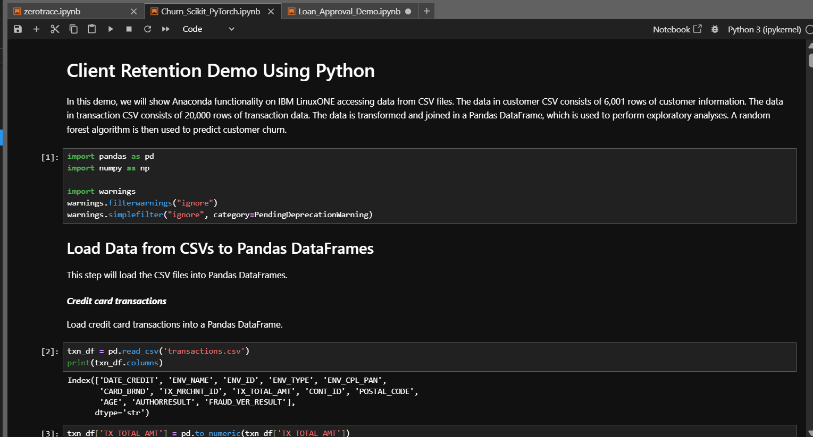 | Notebook running on LinuxONE (tab name visible) |
| 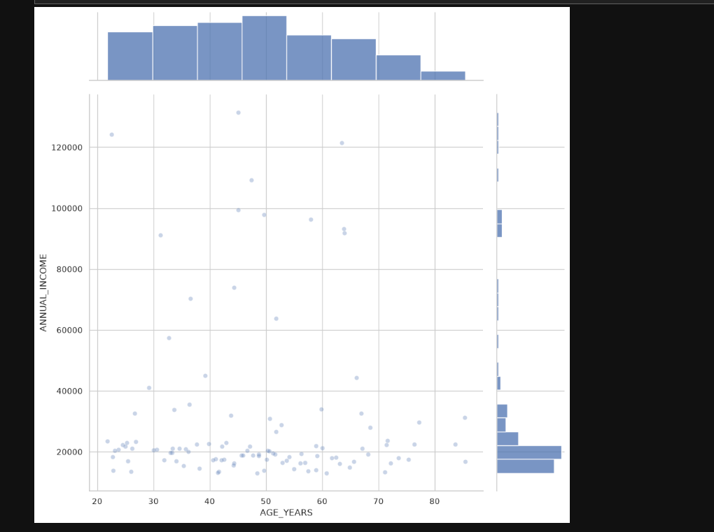 | Age vs annual income distribution |
| 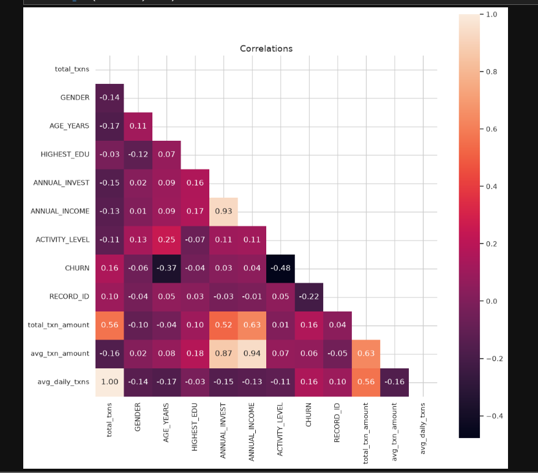 | Feature correlation matrix |
| 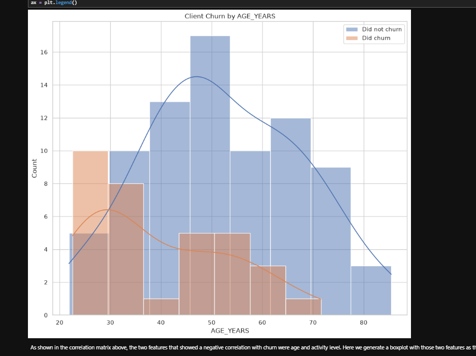 | Churn by age |
| 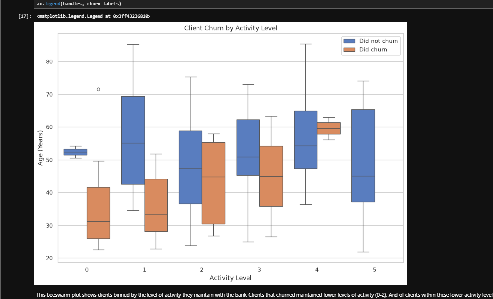 | Churn by activity level (box plot) |
| 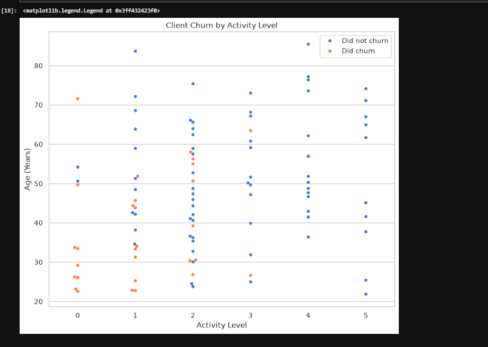 | Churn by activity level (beeswarm) |
| 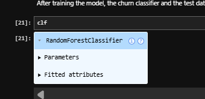 | Trained RandomForestClassifier |
| 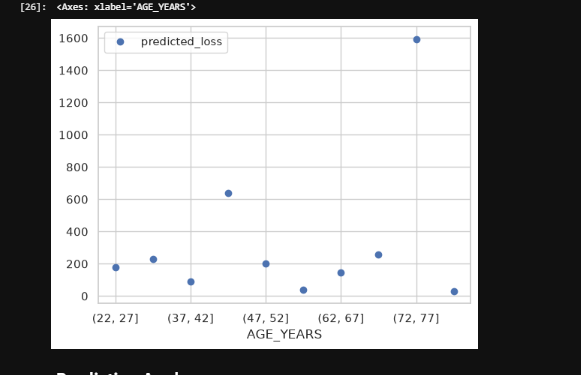 | Predicted loss by age band |
| 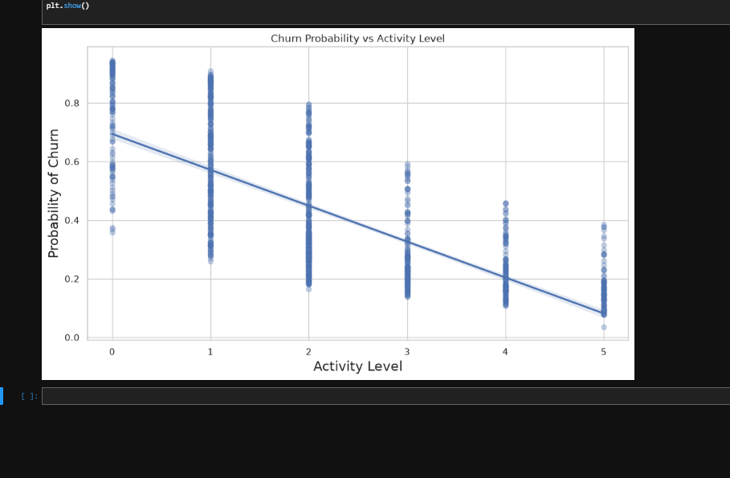 | Predicted churn probability vs activity level |

## Lab 2: Predictive AI + generative AI: `Loan_Approval_Demo.ipynb`

Loan decisioning combining an XGBoost risk model with IBM Granite (llama.cpp built with IBM zDNN / NNPA acceleration) for document feature extraction, retrieval-augmented recommendation and question answering.

| Screenshot | What it shows |
|---|---|
| 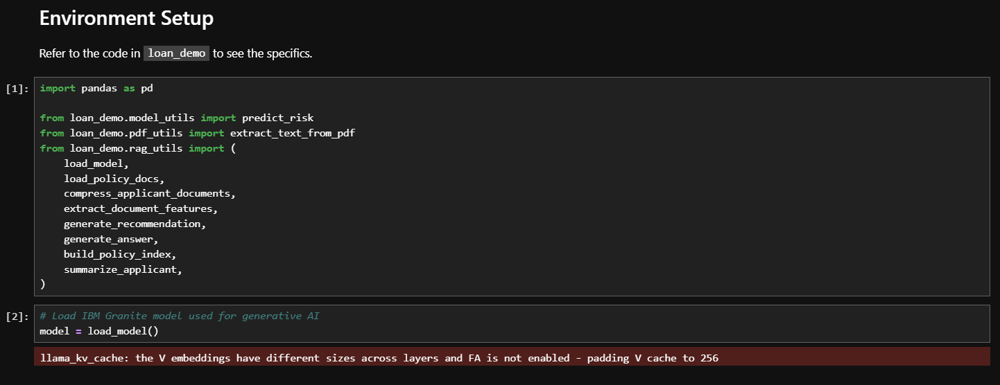 | Loading the IBM Granite model |
| 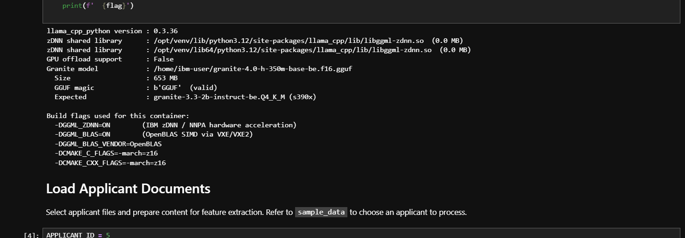 | zDNN shared library present, Granite GGUF valid, build flags `-DGGML_ZDNN=ON` |
| 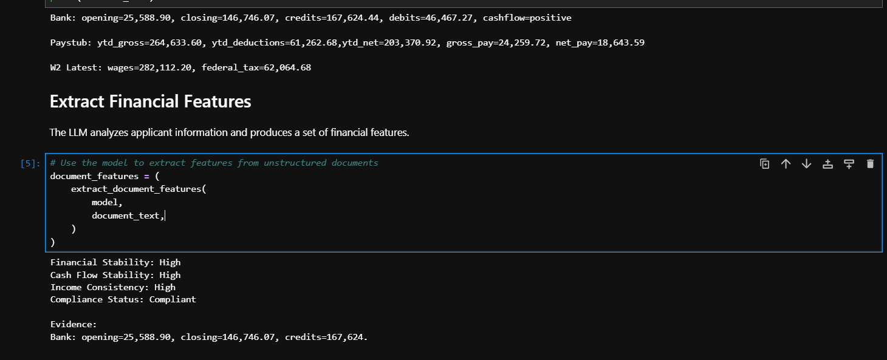 | Granite extracts financial features from bank statements, pay stubs and W-2 |
| 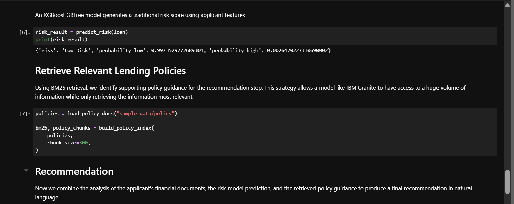 | XGBoost prediction: Low Risk (0.997) |
| 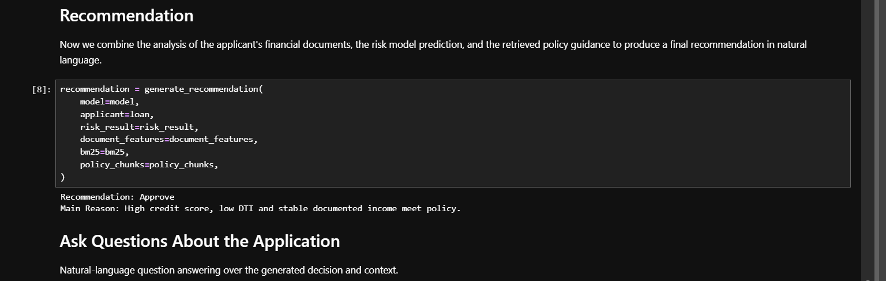 | Granite recommendation: Approve, with reason |
| 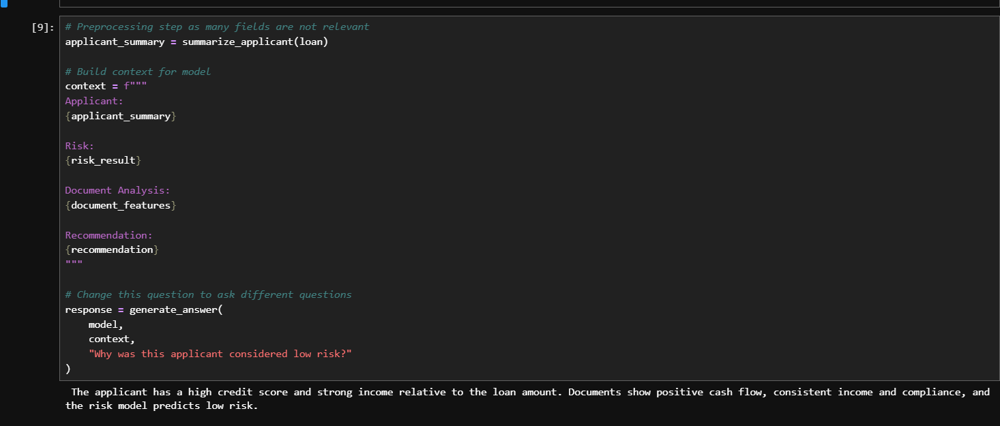 | Granite answers "Why was this applicant considered low risk?" |

## How the labs shaped ZeroTrace

- **Lab 1** (tree-ensemble prediction) → ZeroTrace's ten random-forest slices and ensemble vote.
- **Lab 2** (predictive + generative with Granite) → ZeroTrace's Granite explainer, using the same model and zDNN-accelerated loader, with an added fact-check guardrail.
