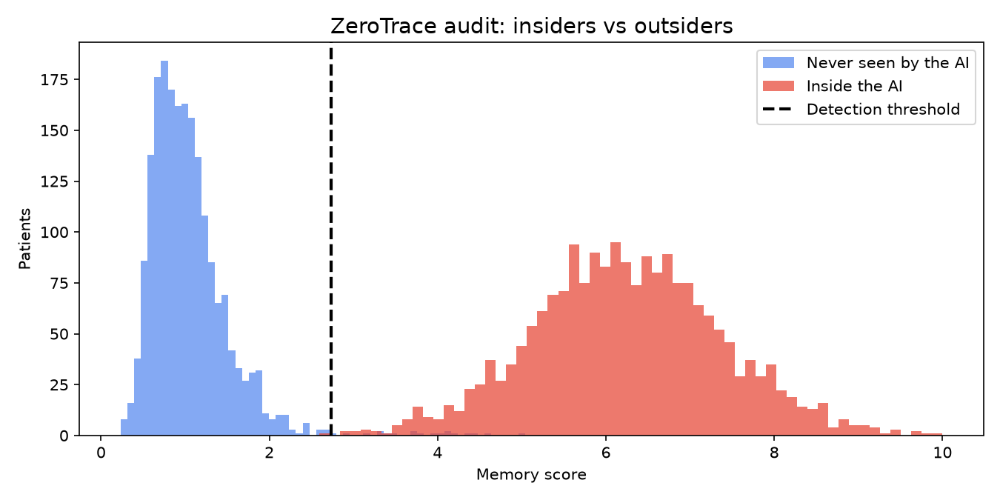
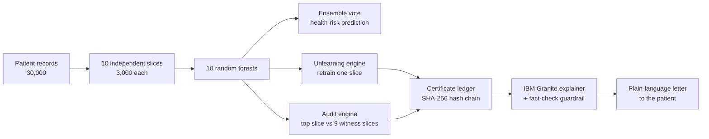
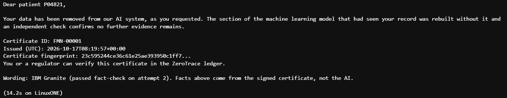
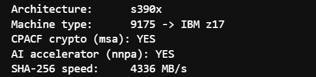
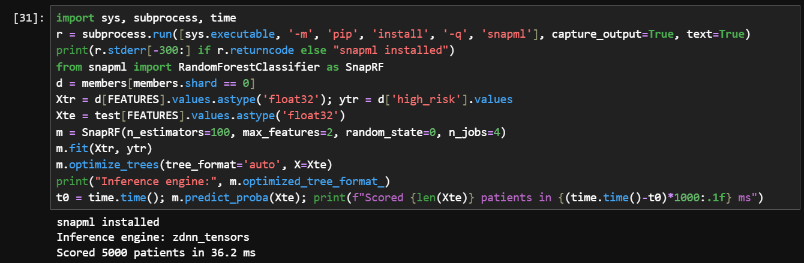

# 🛡️ ZeroTrace_IBM Z Datathon 2026 Project

**Delete a person from the AI. Leave zero trace. Prove it.**

**Team ZeroTrace:** Mohammed Shehadeh · M.Ghaith Ali · Mohamad Alhomsi  
**IBM Z Datathon 2026 · Event code: SSF2026 · Theme 2: AI Secured · Built and running on IBM LinuxONE (IBM z17)**

Privacy laws such as GDPR (Article 17) give people the right to have their personal data deleted. But once that data has trained an AI model, deleting the database record is not enough: the model can still carry traces of the person, and membership-inference attacks can reveal who was in the training data. Today, organizations either ignore the problem or retrain the whole model for every request, and nobody can prove the model actually forgot.

**ZeroTrace** is a privacy audit tool that does three things:

| Step | What it does |
|---|---|
| **1. Detect** | Audits the model to check whether it remembers a specific person, and finds which part of the model holds them |
| **2. Forget** | Deletes the record and retrains only the one slice that saw that person, about 12× faster than a full retrain |
| **3. Prove** | Re-runs the audit and issues a SHA-256, hash-chained deletion certificate that exposes any later tampering |
| **4. Explain** | IBM Granite drafts a plain-language letter to the patient; a fact-check guardrail rejects wrong drafts, and all facts come from the certificate |

## Results (measured on IBM LinuxONE Community Cloud)

| Proof point | Result |
|---|---|
| Patients inside the AI detected | **100%** (2,000 / 2,000) |
| False alarms on never-seen patients | **0.9%** |
| Correct slice located | **99.3%** |
| Detected before forgetting → after | **20 / 20 → 0 / 20** |
| Average time to forget one patient | **0.19 s** (vs 1.08 s full retrain on the demo model) |
| Speed-up at 30k / 60k / 120k patients | **11.4× / 12.6× / 12.0×** |
| Accuracy: one big model vs sliced model after 21 deletions | 71.9% vs **73.1%** |
| Tamper test (edit one patient ID in the ledger) | **Detected** |

## How it works

- **Sliced training (SISA-style).** Each patient is in exactly one slice, so forgetting them only requires retraining that slice. The other nine never saw the patient and stay unchanged.
- **Witness-slice audit.** For each patient, we compare the most confident slice with the other nine. A patient the model trained on stands out sharply in one slice; a stranger does not. The threshold is calibrated to a 1% false-alarm rate on 5,000 never-seen patients.
- **Deletion certificate.** Each certificate records the patient ID, the slice retrained, the before/after audit, before/after accuracy, the model's SHA-256 fingerprint before and after, and the hash of the previous certificate. Editing any certificate breaks the chain. See [`ledger.json`](ledger.json) for the 22 certificates issued during testing (IDs use the prefix `FMN`, the project’s working name).

## Predictive + generative AI: IBM Granite with a guardrail

After each deletion, IBM Granite (the same Granite model and llama.cpp + IBM zDNN loader as the Loan Approval lab) writes a plain-language explanation for the patient. Small language models can get facts wrong; in our first test Granite wrote that the data was "not deleted". So ZeroTrace never lets the model touch facts:

1. Granite gets **no numbers**, only the task and two example explanations.
2. Every draft is **fact-checked**: drafts containing numbers, contradictions ("not deleted", "still", "reduced") or invented technical claims ("layers", "complex process") are rejected, and a draft must state that the data was removed (up to 3 attempts). We tightened this after the first guardrail let through "a complex process requiring multiple layers in training"; in the final run, Granite's first draft was rejected and its second passed.
3. If every draft fails, a **pre-approved explanation** is used, and the letter says so.
4. Certificate ID, date and fingerprint are inserted **by code from the signed certificate**.

## Why IBM LinuxONE

Measured on our LinuxONE Community Cloud instance:

- **IBM z17 (machine type 9175).** The whole pipeline (training, audit, unlearning, certificates, dashboard) runs on it.
- **CPACF on-chip cryptography** is present, and SHA-256, the hash behind every model fingerprint and certificate, runs at **4,336 MB/s**, far above typical software-only speed and consistent with CPACF acceleration.
- **Telum II on-chip AI accelerator (NNPA):** using IBM Snap ML, a ZeroTrace slice model was compiled to `zdnn_tensors` and scored **5,000 patients in 36.2 ms** on the accelerator.

- The organizations holding the most sensitive personal data (banks, hospitals, governments) already run on IBM Z, so auditing and unlearning happen beside the data instead of moving it. At about 0.19 s per deletion, requests can be handled as they arrive.

## Run it

1. Get a LinuxONE Community Cloud Ubuntu 22.04 instance and start the Jupyter Lab container by following [linuxone-community-cloud/jupyter-lab-ml](https://github.com/linuxone-community-cloud/jupyter-lab-ml).
2. Upload `zerotrace.ipynb` in Jupyter Lab.
3. Run all cells in order. The interactive dashboard appears after the Step 9 cells; try **Random insider → Forget Me → Audit → Verify ledger → Explain to patient**.
4. The Granite cells (Step 14) use the `loan_demo` module and Granite model that ship with the LinuxONE Community Cloud Jupyter image.

The container already includes everything needed (see `requirements.txt`). The notebook generates its own data; nothing to download.

## Repository

| File | Contents |
|---|---|
| `zerotrace.ipynb` | Full pipeline with outputs: data, sliced model, audit, unlearning, certificates, dashboard, evidence |
| `ledger.json` | The 22 deletion certificates produced on LinuxONE |
| `audit_separation.png` | Memory scores of insiders vs never-seen patients |
| `platform_check.png`, `telum_snapml.png`, `granite_letter.png` | Live proof from our IBM z17 instance |
| `LAB_EVIDENCE.md` + `lab1_*.png`, `lab2_*.png` | Screenshots of both mandatory labs run on LinuxONE |
| `requirements.txt` | Python packages used |

## Mandatory labs

Both prerequisite labs (Predictive AI hybrid multi-model, and Predictive AI + Generative AI) were completed on our LinuxONE instance. Screenshots: [`LAB_EVIDENCE.md`](LAB_EVIDENCE.md).

## Honest limitations

- The patient data is **synthetic**; no real records were used. The method is unchanged on real data.
- The model must be **built in slices from the start**; an existing single model cannot be retrofitted.
- The audit is **strong statistical evidence**, not a mathematical guarantee. The retrained slice itself never saw the patient, so their influence is removed by design.
- Tested with random forests. Fully grown trees memorize their training rows, which is exactly the privacy risk the audit measures; models that memorize less are harder to detect, which is why ZeroTrace also retrains the slice so removal holds by design.
- The hash chain exposes any edited certificate, but the issuer could rebuild the whole chain. Production would sign each certificate with keys held in an IBM Z hardware security module.

## Next steps

- Extend to neural networks and more slices for faster forgetting.
- Move the full audit pipeline onto Telum II (one slice model already runs there via Snap ML).
- Sign every certificate with IBM Z hardware security module keys, so even the issuer cannot forge or rebuild the chain.
- Pilot on a real, consented dataset.

## Open-source resources

[Python](https://www.python.org/) · [NumPy](https://numpy.org/) · [pandas](https://pandas.pydata.org/) · [scikit-learn](https://scikit-learn.org/) · [Matplotlib](https://matplotlib.org/) · [joblib](https://joblib.readthedocs.io/) · [IBM Snap ML](https://snapml.readthedocs.io/) · [IBM Granite](https://github.com/ibm-granite) · [llama-cpp-python](https://github.com/abetlen/llama-cpp-python) · [ipywidgets](https://ipywidgets.readthedocs.io/) · [Jupyter Lab](https://jupyter.org/) · [Docker](https://www.docker.com/) · [LinuxONE Community Cloud Jupyter Lab image](https://github.com/linuxone-community-cloud/jupyter-lab-ml)

Method references: Bourtoule et al., [*Machine Unlearning*](https://arxiv.org/abs/1912.03817) (SISA training), IEEE S&P 2021 · Shokri et al., [*Membership Inference Attacks against Machine Learning Models*](https://arxiv.org/abs/1610.05820), IEEE S&P 2017.

## Team

Team ZeroTrace: Mohammed Shehadeh · M.Ghaith Ali · Mohamad Alhomsi · IBM Z Datathon 2026

## License

MIT, see [LICENSE](LICENSE).
